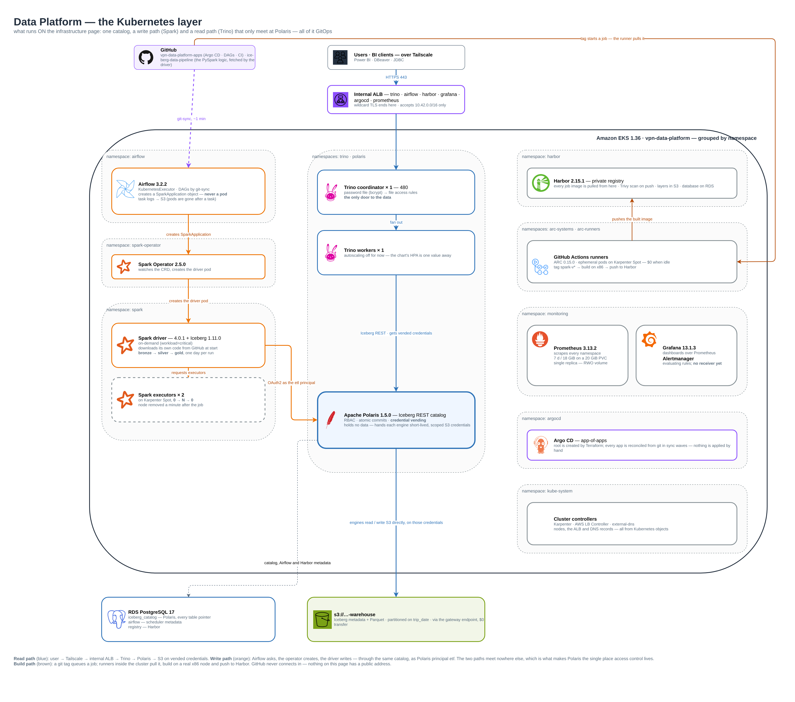
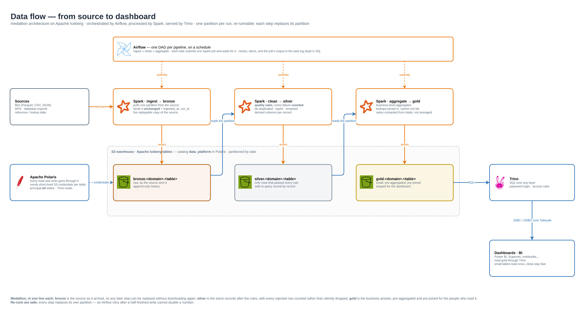

# vpn-data-platform-apps

**Everything that runs on the `vpn-data-platform` cluster — declared in git,
installed and kept in sync by Argo CD.**

An open-source lakehouse (Iceberg, Polaris, Spark, Trino, Airflow) with its own
registry, CI runners, autoscaling and monitoring, reachable only over
Tailscale. Push to `main` and the cluster follows.

Infrastructure — VPC, EKS, RDS, IAM, Argo CD itself — lives in
**[VPN_DATA_PLATFORM](https://github.com/nopega/VPN_DATA_PLATFORM)**. This
repository touches no AWS API and holds no credentials.



## What is installed

| | Application | What you get |
|---|---|---|
| 🧊 | **Apache Polaris 1.5.0** | Iceberg REST catalog shared by every engine · role-based grants per catalog and namespace · **credential vending**: engines get short-lived S3 credentials per table, never bucket-wide access |
| 🔍 | **Trino 480** | SQL over every Iceberg table at `trino.nopega.net` · password login · per-user access rules (BI accounts read `gold` only) · **resource groups** so batch ETL, dashboards and ad-hoc queries cannot starve each other |
| ⚡ | **Apache Spark 4.0.1 + Spark Operator 2.5.0** | a `SparkApplication` is all a job needs · driver on On-Demand, executors on **Spot that exists only while the job runs** · writes Iceberg through Polaris as principal `etl` |
| 🌀 | **Apache Airflow 3.2.2** | UI at `airflow.nopega.net` · KubernetesExecutor — every task is its own pod, no Celery broker, no idle workers · **DAGs straight from this repo** via git-sync (live within a minute of a push) · task logs in S3 · StatsD metrics into Prometheus |
| 📦 | **Harbor 2.15.1** | private registry at `harbor.nopega.net`, image layers in S3 · Trivy vulnerability scanning · separate robot accounts: Spark can only pull, CI can only push |
| 🤖 | **GitHub Actions runners** (ARC) | `git tag spark-v0.3.0 && git push --tags` → a runner **inside the cluster** builds the image and pushes it to Harbor · Docker-in-Docker on Spot, **0 runners when idle** |
| 📈 | **kube-prometheus-stack** | Prometheus, Grafana and Alertmanager at `grafana.nopega.net` / `prometheus.nopega.net` · scrapes the cluster, nodes, Trino and Airflow · 7 days / 18 GiB retention |
| 🖥️ | **Karpenter NodePools** | `general` (On-Demand, up to 16 vCPU) and `spot-batch` (Spot, up to 32 vCPU) · nodes appear for pending pods and **consolidate away** when empty · monthly / weekly node refresh |
| 💾 | **gp3 StorageClass** | encrypted default class, volumes created in the zone the pod lands in |

Every web UI sits behind one internal load balancer with a wildcard
certificate; the hostnames resolve only on the tailnet.

## A pipeline, end to end



`dags/` holds three DAGs:

| DAG | What it proves |
|---|---|
| `platform_smoke_test` | git-sync, the scheduler, task pods and S3 task logs all work |
| `spark_smoke_test` | Airflow submits a SparkApplication and follows it to completion |
| `nyc_taxi_medallion` | a full medallion pipeline on public trip data: **bronze → silver → gold**, one partition per run, daily |

What makes the pipeline safe to run and re-run:

- **Each step replaces its own partition** — a retry after a half-finished
  write cannot double a number; backfilling a day is just triggering that day.
- **Lineage on every bronze row** — `_ingested_at`, `_source_file`, `_run_id`.
- **Code and image are versioned separately.** The Spark image is built by CI
  from a git tag; the PySpark code is fetched by the driver from
  `nopega/ice-berg-data-pipeline` at a pinned ref, set per run.
- **No credentials in the job.** The Spark pod has a Pod Identity role for its
  event logs only; table access comes from Polaris, per table, per run.

## How it is connected

```
git push ─▶ root Application (created by Terraform, watches apps/)
         ─▶ one Application per file in apps/
         ─▶ chart or manifests deployed, in sync-wave order, then kept in sync
```

A fresh cluster needs no manual `kubectl apply`: Argo CD starts, reads
`apps/`, and installs everything below in order. **Waves really wait** — the
infrastructure repository gives Argo CD a health check for Application
objects, so a wave starts only when the one before it is Healthy.

| Wave | Application | Namespace | One-time step first (infra repo) |
|---|---|---|---|
| -40 | `storage` | kube-system | — |
| -30 | `karpenter-nodepools` | kube-system | `terraform/07_karpenter` |
| -20 | `polaris` | polaris | `bootstrap/polaris.sh` |
| -10 | `monitoring` | monitoring | `bootstrap/monitoring.sh` |
| 0 | `smoke-test` | smoke-test | — |
| 10 | `trino` | trino | `bootstrap/polaris_catalog.sh`, `bootstrap/trino.sh` |
| 20 | `harbor` | harbor | `terraform/08_registry`, `bootstrap/harbor.sh` |
| 30 | `spark-operator` | spark-operator, spark | `terraform/09_spark`, `bootstrap/spark.sh` |
| 40 | `airflow` | airflow | `terraform/10_airflow`, `bootstrap/airflow.sh` |

The CI runners are installed by `terraform/11_ci` in the infrastructure
repository, because they need a GitHub token before they start.

### Built to survive GitOps

Charts that generate keys or certificates while rendering (Harbor, Airflow)
would rotate them on every Argo CD sync. Every such value is created once by
a bootstrap script and referenced as an existing Secret, so a sync never
changes a credential. Hooks that deadlock under Argo CD are replaced by
Argo CD's own sync hooks.

## Repository layout

```
apps/        one Argo CD Application per component — root watches this folder
next/        staging for Applications not enabled yet (empty now; root does not look here)
charts/      vendored Helm charts: polaris, trino, harbor, spark-operator, airflow
values/      values for charts pulled from upstream (kube-prometheus-stack)
workloads/   plain manifests: Ingresses, NodePools, RBAC, StorageClass, ServiceMonitors
dags/        Airflow DAGs and their SparkApplication templates (git-synced)
images/      the Spark job image (Dockerfile, build script, smoke-test job)
runs/        one-off SparkApplications to apply by hand
.github/     the image build workflow, run on the in-cluster runners
docs/        diagrams (source: VPN_DATA_PLATFORM/docs/diagrams)
```

## Changing things

```bash
# enable a component from next/ — after its bootstrap script has run
git mv next/<name>.yaml apps/ && git commit -m "Enable <name>" && git push

# ship a new Spark image
git tag spark-v0.3.0 && git push origin spark-v0.3.0

# add or change a DAG
edit dags/… && git push        # live in Airflow within about a minute
```

Secrets never come from this repository: each component's bootstrap script
in the infrastructure repository creates them first.

More on components, data layout, governance and cost:
[VPN_DATA_PLATFORM/docs](https://github.com/nopega/VPN_DATA_PLATFORM/tree/main/docs).
